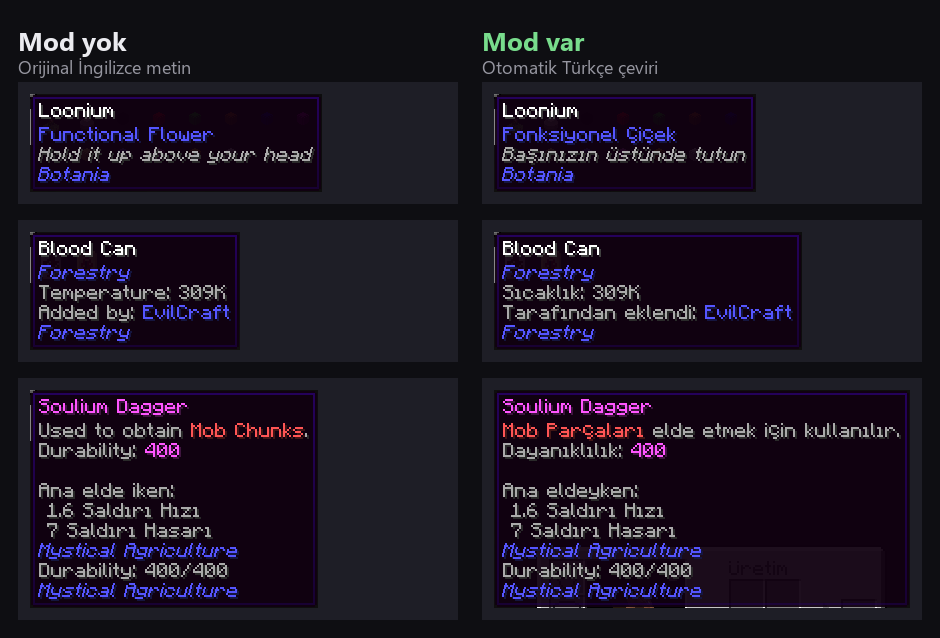
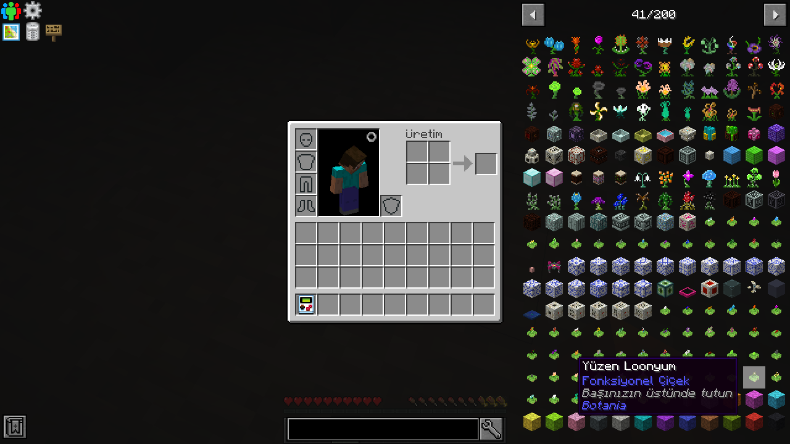

<div align="center">

# AutoTranslation

**Her modpack'i kendi dilinde oyna. Kaynak paketi yok, mod yazarını beklemek yok.**

AutoTranslation, modlarındaki İngilizce yazıları oynarken Minecraft'ta seçtiğin dile çeviren, **istemci taraflı** bir
Minecraft modudur: eşya adları, ipuçları, menüler, FTB Quests, Patchouli kitapları ve daha fazlası. Almanca, İspanyolca,
Türkçe, Japonca: çeviri hizmetinin desteklediği her dil.

[](LICENSE)
[](https://github.com/yuefdev/minecraft-ai-translator/stargazers)
[](https://github.com/yuefdev/minecraft-ai-translator/actions)


[English](README.md) · [Kurulum](#kurulum) · [Desteklenen sürümler](#desteklenen-sürümler) · [Ayarlar](#ayarlar) · [Sık sorulanlar](#sık-sorulanlar)



<sub>Aynı eşyalar, aynı dünya, Minecraft 1.12.2 (StoneBlock), oyun dili Türkçe. Solda mod kaldırılmış, sağda mod kurulu.</sub>

</div>

---

## Neden

Modların çoğu yalnızca İngilizce gelir; çeviri istekleri aylarca bekler ya da hiç birleştirilmez. Büyük bir modpack'te
on binlerce yazı vardır. AutoTranslation bunları arka planda çevirir ve sonucu hatırlar.

Bir StoneBlock oyunundan (yaklaşık 38.000 yazı) gerçek çıktı. Oyun dili Türkçe, yani modun ayarlanıp sınandığı dil. Anahtarsız Google Çeviri, elle düzeltme yok:

| Mod | İngilizce | Türkçe |
|---|---|---|
| Ender IO | `Reanimated Enderman Head` | `Yeniden Canlandırılmış Enderman Kafası` |
| Applied Energistics 2 | `4k ME Fluid Storage Cell` | `4k ME Sıvı Depolama Hücresi` |
| Botania | `Block of Lavender Quartz` | `Lavanta Kuvars Bloğu` |
| Cyclic | `Drain fluid that is nearby and below, filling it with blocks` | `Yakındaki ve altındaki sıvıyı boşaltın, bloklarla doldurun` |
| Forestry | `Generates copper ore blocks in the world.` | `Dünyada bakır cevheri blokları üretir.` |
| Forestry | `Players who enter the world for the first time get a Forester's Manual.` | `Dünyaya ilk kez giren oyunculara bir Ormancının El Kitabı verilir.` |
| Draconic Evolution | `Auto feed is disabled.` | `Otomatik besleme devre dışı.` |

Makine çevirisi kusursuz değildir: Gemini anahtarı daha iyi sonuç verir, geri kalanı sözlük ve kendi düzeltmelerinle
(bkz. [Ayarlar](#ayarlar)) düzeltirsin. `Loonium` gibi özel adlar olduğu gibi kalır.

Renk kodları (`§6…§r`), yer tutucular (`%s`, `{name}`), bağlantılar ve Patchouli komutları olduğu gibi korunur.
Bunlardan birini bozan çeviri reddedilir.

<div align="center">

</div>

## Özellikler

- **Kurulumsuz çalışır.** Hiçbir şey yapmasan da anahtarsız Google Çeviri kullanılır. Daha iyi, bağlamı anlayan
  çeviri için ücretsiz bir [Gemini](https://aistudio.google.com/apikey) anahtarı yapıştır. Groq, Mistral, OpenRouter,
  bilgisayarında çalışan [Ollama](https://ollama.com) ve OpenAI uyumlu her hizmet de olur. Hangi hizmet olduğunu
  anahtardan anlar.
- **Her modu kendiliğinden çevirir.** Senin dilinde dosyası olmayan modların dil dosyaları ve ekranlara koda gömülü
  İngilizce yazılar. Güncel tutulacak bir mod listesi yok.
- **Görevler ve kitaplar.** FTB Quests (başlıklar, alt başlıklar, açıklamalar, hedefler, ödüller), Patchouli
  kitapları ve 1.12.2'de BetterQuesting.
- **Oyun verine dokunmaz.** Çeviri yazı ekrana çizilirken yapılır. Görev kimlikleri, koşullar, ödüller, komutlar ve
  ilerleme olduğu gibi kalır.
- **Kalıcı, çevrimdışı önbellek.** Her yazı bir kez çevrilir, sonra internetsiz de çalışır.
- **Arka planda toplu ön çeviri (1.12.2).** Açılışta tüm modların dil dosyalarını çevirir; çoğu yazı ilk
  göründüğünde zaten çevrilmiştir.
- **Ortak çeviri paketleri.** Hazır çeviriler indirilir (yalnızca indirme, hiçbir şey yüklenmez) ve çeviri hizmetine
  sorulmadan önce kullanılır. Popüler bir paketin yeni kurulumu büyük ölçüde çevrilmiş başlar. Bugün yalnızca Türkçe için paket var; diğer
  dillerde çeviri hizmeti kullanılır.
- **Son söz senin.** Düzenlenebilir sözlük (aynı eşya hep aynı adı alır) ve her şeyi geçersiz kılan kendi
  düzeltmelerin.
- **Sınırlara saygılı.** Kısa yazılar tek istekte gönderilir. Ücretsiz kota dolunca önce yedek modele, sonra anahtarsız
  Google'a geçer; önbellekteki çeviriler görünmeye devam eder.
- **Senin yazdığını çevirmez.** Sohbet, tabela, kitap ve isim verme ekranlarına dokunmaz.

## Desteklenen sürümler

| Minecraft | Yükleyici | Java | Görevler ve kitaplar | Ayarlar |
|---|---|---|---|---|
| 1.20.1 | Forge 47 | 17 | FTB Quests, Patchouli | Oyun içi ekran (Türkçe) |
| 1.21.1 | NeoForge 21.1 | 21 | FTB Quests, Patchouli | `settings.json` |
| 26.1.2 | NeoForge 26.1.2 | 25 | FTB Quests | `settings.json` |
| 1.19.2 | Forge 43 | 17 | FTB Quests, Patchouli | `settings.json` |
| 1.18.2 | Forge 40 | 17 | FTB Quests, Patchouli | `settings.json` |
| 1.16.5 | Forge 36 | 8+ | FTB Quests, Patchouli | `settings.json` |
| 1.12.2 | Forge 14.23.5 | 8 | BetterQuesting, FTB Quests, Patchouli | `settings.json` |

Her sürüm CI'da derlenir ve gerçek bir Minecraft istemcisinde, isteğe bağlı modlarla ve onlarsız açılır.
Neyin sınandığı ve neyin sınanmadığı: [`docs/VERIFICATION.md`](docs/VERIFICATION.md). Fabric kodu depoda durur ama
henüz derlenmez ve sınanmaz.

## Kurulum

1. Sürümüne uygun jar'ı [Releases](https://github.com/yuefdev/minecraft-ai-translator/releases) sayfasından indirip
   `mods/` klasörüne koy.
2. **Yalnızca 1.20.1:** [Architectury API](https://modrinth.com/mod/architectury-api) ve
   [Cloth Config](https://modrinth.com/mod/cloth-config) de gerekir. Diğer sürümlerde ek mod gerekmez.
3. Oyunda **Seçenekler → Dil** bölümünden istediğin dili seç, örneğin Deutsch, Español ya da Türkçe.

Hepsi bu. Görev ve kitap modları kuruluysa çevrilir; kurulu değilse oyun normal açılır.

> Oyun dili İngilizce ise hiçbir şey çevrilmez. Mod yalnızca seçtiğin dil için çalışır.

### Ücretsiz Gemini anahtarıyla daha iyi çeviri (önerilen)

Google Çeviri hızlıdır ama bağlamı bilmez. Yapay zekâ cümleyi anlamıyla çevirir. Ücretsiz katman için kredi kartı
gerekmez.

1. <https://aistudio.google.com/apikey> adresinden anahtar oluştur.
2. Moda şu yollardan biriyle ver:
   - ortam değişkeni `AUTOTRANSLATION_API_KEY`, ya da
   - oyun klasöründe `AutoTranslation/secrets/api-key.txt` dosyası (içinde yalnızca anahtar), ya da
   - 1.20.1'de: **Mods → AutoTranslation → Config → Sağlayıcı**.
3. Oyunu yeniden başlat. Mod anahtardan Gemini olduğunu anlar ve kendiliğinden geçer.

Anahtar ayar dosyalarına ve log'lara yazılmaz.

## Ayarlar

Dosyalar `<oyun klasörü>/AutoTranslation/` altındadır.

| Dosya | Ne için |
|---|---|
| `settings.json` | Sağlayıcı, model, dakikadaki istek, neyin çevrileceği. İlk açılışta oluşur. |
| `glossary.json` | Hep aynı çevrilmesi gereken terimler. |
| `corrections.json` | Belirli bir İngilizce yazı için kendi çevirin. En yüksek önceliklidir. |
| `cache/translations.jsonl` | Çevrimdışı önbellek. Silmek güvenlidir. |

`settings.json` içindeki işe yarar seçenekler:

| Seçenek | Varsayılan | Anlamı |
|---|---|---|
| `provider` | `"auto"` | `auto`, `google-free`, `gemini`, `groq`, `mistral`, `openrouter`, `ollama` ya da `custom` |
| `pretranslateLanguageFiles` | `true` | Tüm mod dil dosyalarını arka planda çevir (1.12.2) |
| `sharedPacks` | `true` | İndirilen hazır çevirileri kullan. Tüm paket indirmelerini kapatmak için `false` yap. |
| `showOriginal` | `false` | Çevirinin yanında İngilizcesini göster |
| `requestsPerMinute` | `60` | Çeviri hizmeti için istek sınırı |

1.20.1'de ayar ekranı (*Mods → AutoTranslation → Config*) şu sekmelerden oluşur: **Genel**, **Sağlayıcı** (uç nokta,
model, anahtar, bağlantı sınaması), **Sözlük**, **Düzeltmeler**, **Durum** (kuyruk, önbellek, son hata).

1.12.2 için adım adım anlatım: [`docs/KURULUM_1.12.2.md`](docs/KURULUM_1.12.2.md). Diğer sürümler:
[`docs/VERSIONS.md`](docs/VERSIONS.md).

## Gizlilik

- **Mod yazıları, kullandığın çeviri hizmetine gönderilir.** Varsayılan Google Çeviri'nin anahtarsız uç noktasıdır;
  anahtar girersen o anahtarın hizmetidir. Yalnızca modların ve oyunun yazıları gider. Senin yazdıkların hiç gitmez.
- **Ortak paketler yalnızca indirmedir.** Mod, bir paket sitesinden statik dosyalar alır; kullanmadan önce her birini
  SHA-256 sağlaması ve özgün yazının yer tutucularıyla denetler. Oyunundan hiçbir şey yüklenmez. Paketlerde İngilizce
  kaynak yazı yoktur; yalnızca özetler ve çeviriler vardır. Kapatmak için `"sharedPacks": false`.
  Ayrıntı: [`docs/ORTAK_PAKET.md`](docs/ORTAK_PAKET.md).
- API anahtarları ayar dosyalarına ve log'lara yazılmaz.

## Sık sorulanlar

**Hiçbir şey çevrilmiyor.** Oyun dilinin İngilizce olmadığını ve `settings.json` içinde `enabled` değerinin `false`
olmadığını kontrol et.

**Bazı yazılar birkaç saniye İngilizce kalıyor.** Yazı ilk gösterildiğinde çevrilir; sonrasında önbellekten gelir.

**Sunucu modu mu?** Hayır. İstemci taraflıdır, her sunucuda çalışır.

**Anahtarsız Google güvenilir mi?** Resmî olmayan bir uç noktadır, sınırı düşüktür (dakikada yaklaşık 20 istek) ve
çok istek görürse Google bir süre engelleyebilir. Kurulumsuz yedektir. Ücretsiz Gemini anahtarı hem kalitede hem
sınırlarda daha iyidir.

**Hangi diller?** Hedef dil, **Seçenekler → Dil**'de seçtiğin dildir ve motor her Minecraft dil koduyla çalışır.
Ayarlanıp (istem yazımı, ortak paket) sınanan dil Türkçedir. Diğer diller aynı hattı kullanır ama henüz doğrulanmadı;
bildirimler çok işe yarar.

**Kötü bir çeviriyi düzeltebilir miyim?** Evet. `corrections.json` dosyasına ekle ya da 1.20.1'de Düzeltmeler
sekmesini kullan.

**Çeviri her zaman doğru mu?** Hayır, makine çevirisidir. Kötü örnekleri bildir. Düzeltmeler ve sözlük tam bunun
için var.

**Bilinen sınırlar:** dokuların içine çizilmiş yazılar çevrilmez. Patchouli `$(t:…)` ipuçları çevrilmez. Sayıların
sırası serbesttir ama `3/10`, `12:30` gibi çiftlerin sırası değişirse çeviri reddedilir.

## Kaynaktan derleme

```bash
./gradlew :core:test       # ağ gerektirmeyen motor testleri
./gradlew :forge:build     # 1.20.1 jar'ı, forge/build/libs/ altında
```

Diğer sürümler `versions/` altındadır ve `versions.yml` iş akışıyla derlenir. Tasarım:
[`docs/DESIGN.md`](docs/DESIGN.md).

## Katkı

Sorunlar ve çekme istekleri (pull request) açıktır. Özellikle log'lu hata bildirimleri, kendi dilin için sözlük girdileri, yeni dillerin doğrulanması
ve yeni sürüm desteği çok işe yarar. Çekme isteğinden önce motor testlerini çalıştır.

## Lisans ve atıflar

AutoTranslation, **GNU Affero Genel Kamu Lisansı v3.0** ile sunulan özgür yazılımdır ([LICENSE](LICENSE)).

1.20.1 modülü (`common/`, `forge/`, `fabric/`), 墨涤千尘'in
[AutoTranslation](https://github.com/Moirstral/AutoTranslation) projesini (AGPL-3.0) temel alır. Çeviri motoru
(`core/`), diğer sürüm modülleri (`versions/`), çeviri hattı, görev ve kitap entegrasyonları ve ortak paketler bu
projede eklenmiştir. Ayrıntı: [NOTICE.md](NOTICE.md).

FTB Quests, Patchouli, BetterQuesting, Architectury API ve Cloth Config yazarlarına aittir ve bu depoda dağıtılmaz.
